# الأكواخ السويسرية — وثيقة تحليل ومتطلبات المشروع

Nov 22, 2026 · @rawaa

## 1. الملخص التنفيذي والنطاق

موقع "الأكواخ السويسرية" منصة حجز إلكترونية لأكواخ ومزارع سياحية في سوريا، تُطلق نسختها الأولى خلال يومين بالحجز المباشر والدفع الكامل عبر شام كاش وتثبيت يدوي من مدير الفرع.

**الفروع:** إدلب، حمص، ودمشق (تظهر بعبارة "قريبًا"). لكل فرع عدة وحدات (أكواخ ومزارع)، وكل وحدة فيها مسبح.

**الأهداف:**

1. حجز إلكتروني كامل بدون مكالمات، مع منع الحجز المزدوج بشكل قاطع.
2. واجهات عصرية وراقية جدًا تعكس فخامة المكان، وسريعة على الموبايل والإنترنت الضعيف.
3. لوحة تحكم لكل فرع يدير فيها وحداته ومواسمه وفتراته وأسعاره وحجوزاته وموظفيه.
4. حماية الموقع من الحجوزات المزورة التي تعطّل الأوقات.

**داخل نطاق المرحلة الأولى (MVP):**

- الموقع العام: الرئيسية، صفحة الفرع، صفحة الوحدة، تقويم التوفر، مسار الحجز والدفع، صفحة حالة الطلب، صفحة شروط الحجز.
- زر واتساب عائم في كل الصفحات، رقمه يحدده المدير العام لكل صفحة.
- لوحة الفرع: الوحدات، الصور، المواسم، أنماط التشغيل، الفترات والأسعار، فتح وإغلاق الأيام، مراجعة الحجوزات وتثبيتها أو رفضها أو حظر صاحبها، الموظفين والصلاحيات، إعدادات الفرع.
- لوحة المدير العام (مبسطة): الفروع، مدراء الفروع، أرقام الواتساب وتوزيعها، الإعدادات العامة والنصوص، عرض كل الحجوزات.
- إشعارات تيليغرام فورية للمدير والموظفين.

**خارج النطاق (المرحلة الثانية):** التقييمات، التقارير المالية، إشعارات واتساب التلقائية (API)، رمز التحقق OTP، اللغة الإنجليزية، تطبيق موبايل.

**القرارات التقنية:** ASP.NET Core 10 (LTS) MVC، وقاعدة بيانات PostgreSQL، واستضافة Hostinger VPS (KVM 2)، والدومين swiss-chalets أو swisschalets-sy.

## 2. الأدوار والصلاحيات

تثبيت الحجز صلاحية الفرع وحده (المدير أو موظف منحه إياها)، والمدير العام يرى كل الحجوزات للعرض فقط.

| الدور | النطاق | أهم ما يفعله |
| --- | --- | --- |
| الزائر / الزبون | الموقع العام، بدون حساب | يتصفح، يحجز باسمه ورقم واتسابه، يدفع ويرفع الإشعار، يتابع حالة طلبه |
| مدير النظام (المدير العام) | كل الفروع | يدير الفروع ومدراءها، يوزع أرقام الواتساب على الصفحات، يضبط العملة وسعر الصرف ونصوص الثبوتيات وقوالب الرسائل، يعرض كل الحجوزات وسجل العمليات. **لا يثبّت الحجوزات** |
| مدير الفرع | فرعه فقط | كل صلاحيات الفرع، ويضيف موظفين ويمنحهم جزءًا من صلاحياته |
| موظف الفرع | فرعه فقط | ما منحه إياه المدير فقط، ولا يضيف موظفين |

**صلاحيات الفرع القابلة للتوزيع** (رموز ثابتة في الكود):

| الرمز | الصلاحية | مدير الفرع | موظف |
| --- | --- | --- | --- |
| units.manage | إضافة الوحدات وتعديلها وصورها | ✓ | حسب المنح |
| pricing.manage | المواسم وأنماط التشغيل والأسعار | ✓ | حسب المنح |
| slots.manage | الفترات ومواعيد الفندقي | ✓ | حسب المنح |
| calendar.manage | فتح الأيام وإغلاقها | ✓ | حسب المنح |
| bookings.view | عرض الحجوزات وصور الإشعارات | ✓ | حسب المنح |
| bookings.review | تثبيت الحجز أو رفضه، وتسجيل "ملغى لعدم الثبوتيات" | ✓ | حسب المنح |
| blocklist.manage | الحظر ورفعه | ✓ | حسب المنح |
| branch.settings | حساب شام كاش وأوقات المراجعة | ✓ | ✗ |
| staff.manage | إضافة الموظفين وتوزيع الصلاحيات | ✓ | ✗ (لا يُمنح) |

**قواعد:** لا يمنح المدير صلاحية لا يملكها، وكل عملية تثبيت أو رفض أو حظر أو تعديل سعر تُسجل في سجل العمليات (Audit Log) باسم من نفذها ووقتها. تعطيل موظف ينهي جلساته فورًا.

## 3. قواعد العمل (Business Rules)

كل قاعدة هنا ملزمة وتُفرض من طرف السيرفر، لا من الواجهة فقط.

### 3.1 المواسم وأنماط التشغيل

- **BR-01** لكل فرع 4 مواسم (صيفي، شتوي، ربيعي، خريفي) يحدد مدير الفرع تواريخها. يمنع النظام تداخل موسمين في نفس الفرع، وأي يوم لا يقع في موسم غير متاح.
- **BR-02** لكل وحدة في كل موسم نمط تشغيل واحد يختاره المدير:
  - **نمط المسبح (Pool):** فترات 6 ساعات، أو 10 ساعات، أو يوم كامل (24 ساعة). متاح بالصيف، وبالشتاء للوحدات ذات المسبح المدفأ.
  - **النمط الفندقي (Hotel):** مبيت بالليلة، من وقت دخول إلى وقت خروج في اليوم التالي. النمط الوحيد بالربيع والخريف، وبالشتاء للوحدات غير المدفأة.
- **BR-03** بالربيع والخريف لا يسمح النظام باختيار نمط المسبح.

### 3.2 الفترات والأسعار

- **BR-04** مدير الفرع يعرّف لكل وحدة ولكل موسم فتراتها: الاسم (مثلًا "صباحية")، النوع (6 س / 10 س / يومي / ليلة فندقية)، وقت البداية، المدة، السعر. الفترة يمكن أن تعبر منتصف الليل.
- **BR-05** السعر ثابت للفترة مهما كان عدد الأشخاص، ضمن السعة القصوى للوحدة.
- **BR-06** أي فترتين متداخلتين زمنيًا لنفس الوحدة لا يمكن حجزهما معًا. حجز فترة 6 ساعات يقفل تلقائيًا اليومي وأي فترة تتداخل معها، حتى لو كانت في اليوم التالي.
- **BR-07** السعر يُثبّت داخل الحجز لحظة إنشائه، ولا يتأثر بأي تعديل لاحق.
- **BR-08** النمط الفندقي يسمح بحجز عدة ليالٍ متتالية في حجز واحد، والمجموع = مجموع أسعار الليالي.

### 3.3 التوفر والتقويم

- **BR-09** اليوم متاح فقط إذا: فتحه المدير، ووقع في موسم، ولم يمضِ، وبقيت فيه فترة واحدة قابلة للحجز على الأقل. لا يوجد حد زمني ثابت للحجز المسبق.
- **BR-10** ثلاث حالات لليوم في التقويم: **متاح بالكامل** (كل فتراته فارغة)، **محجوز جزئيًا** (بعض الفترات متاحة) بلون مختلف، و**غير متاح** (مغلق، بلا موسم، ماضٍ، أو محجوز بالكامل) بالرمادي وغير قابل للضغط.
- **BR-11** الضغط على يوم يعرض فتراته مع أسعارها، والفترات المحجوزة أو المقفلة بالتداخل تظهر رمادية.
- **BR-12** الحجوزات بحالة "محجوز مؤقتًا" أو "بانتظار التأكيد" أو "مثبّت" كلها تشغل الوقت.
- **BR-13** لا يمكن للمدير إغلاق يوم، أو حذف فترة، أو تغيير موسم أو نمط، إذا كان ذلك يمس حجزًا قائمًا (BR-12). يظهر له سبب المنع والحجوزات المتأثرة.

### 3.4 الحجز والدفع

- **BR-14** الحجز يتم حصرًا عبر الموقع. واتساب للاستفسار فقط.
- **BR-15** بيانات الزبون: الاسم، رقم الواتساب، نوع الحجز (عائلي / شبابي)، عدد الأشخاص، ملاحظات اختيارية.
- **BR-16** لكل وحدة إعداد "الفئات المقبولة": عائلي فقط، أو عائلي وشبابي. الوحدة العائلية فقط لا تعرض خيار "شبابي". السعر نفسه للفئتين.
- **BR-17** التثبيت يتطلب دفع **كامل** المبلغ عبر شام كاش إلى حساب الفرع نفسه. تظهر بيانات الحساب ورمز QR الخاص بالفرع في خطوة الدفع.
- **BR-18** العملة الأساسية الدولار والدفع بالدولار. العملة إعداد عام قابل للتغيير، وإذا فُعّل الدفع بالليرة يحدد المدير العام سعر الصرف ويعرض النظام المبلغ بالعملتين (ويُحفظ سعر الصرف داخل الحجز).
- **BR-19** بعد إدخال البيانات يُحجز الوقت مؤقتًا **30 دقيقة** مع عداد ظاهر. خلالها يدفع الزبون ويدخل رقم العملية ويرفع صورة الإشعار. إذا انتهت المهلة بدون إشعار ينتهي الحجز ويعود الوقت متاحًا.
- **BR-20** بعد رفع الإشعار يصبح الحجز "بانتظار التأكيد" ويبقى الوقت باسم الزبون **بدون أي إلغاء تلقائي**، لأن الزبون دفع.
- **BR-21** رقم عملية شام كاش إلزامي وفريد على مستوى النظام كله، ولا يُقبل مرتين.

### 3.5 أوقات المراجعة

- **BR-22** كل فرع يحدد أوقات المراجعة (مثلًا 9:00 – 23:00)، وتظهر للزبون في نافذة آلية الحجز وصفحة الانتظار.
- **BR-23** الطلب المرفوع إشعاره خارج أوقات المراجعة يبقى محجوزًا باسم الزبون حتى بدء المراجعة. مع بدء المراجعة تبدأ مهلة **30 دقيقة** لمراجعته: يظهر أولًا في القائمة مع تنبيه تيليغرام، وإذا انتهت المهلة يصل تنبيه تصعيد للمدير والمدير العام. الطلب لا يُلغى تلقائيًا.
- **BR-24** الطلب داخل أوقات المراجعة: نفس مهلة الـ 30 دقيقة والتصعيد، تبدأ من لحظة رفع الإشعار.

### 3.6 التثبيت والرفض والإلغاء

- **BR-25** المراجع يرى صورة الإشعار ورقم العملية والمبلغ المطلوب، ويتحقق من تطبيق شام كاش، ثم يختار: **تثبيت**، أو **رفض مع سبب**، أو **رفض وحظر**.
- **BR-26** بعد التثبيت أو الرفض يظهر زر "إرسال عبر واتساب" يفتح محادثة الزبون برسالة جاهزة من القالب (رابط wa.me، مجاني). الرفض يُرجع الوقت متاحًا فورًا.
- **BR-27** المبلغ الناقص أو أي مشكلة دفع: مدير الفرع يتواصل مع الزبون بزر واتساب من صفحة الحجز قبل القرار، وأي استرداد يتم خارج النظام.
- **BR-28** لا يوجد إلغاء ولا استرداد من طرف الزبون.
- **BR-29** الثبوتيات عند الوصول (نص يعدله المدير العام): العائلي = هوية + دفتر عائلة، الشبابي = هوية واحدة. في حال عدم إحضارها يعتبر الحجز لاغيًا، ويسجله المدير بحالة "ملغى لعدم الثبوتيات". تظهر هذه الملاحظة في نافذة آلية الحجز بدون مربع موافقة.
- **BR-30** الحجز المثبّت يتحول إلى "مكتمل" تلقائيًا بعد انتهاء آخر فترة فيه.

### 3.7 قرارات المراجعة (23 نوفمبر)

- **BR-31** الرفع المتأخر: إذا انتهت مهلة الـ 30 دقيقة (Expired) يبقى رابط الحجز يسمح برفع الإشعار، بشرط أن تكون الفترة ما زالت فارغة ولم تنتهِ. عندها يعود الحجز إلى PendingReview. وإذا حُجزت لغيره تظهر رسالة مع زر واتساب للفرع.
- **BR-32** لا يوجد حد أدنى قبل بداية الفترة: يمكن حجز أي فترة فارغة حتى لو بدأت، ما دامت لم تنتهِ.
- **BR-33** أوقات المراجعة تبقى كما هي بدون قيود إضافية على الحجز الليلي.
- **BR-34** حجز يدوي من المدير: من لديه bookings.review يستطيع إنشاء حجز مثبّت مباشرة من اللوحة (بدون إشعار إلزامي)، بنفس قيود التداخل، ويُسجل في سجل العمليات بعلامة "يدوي".
- **التقنية:** المشروع انتقل إلى **Next.js + PostgreSQL** بدل ASP.NET Core، وسيُحدّث القسم 9 والبرومبت بعد اعتماد التصاميم.

### 3.8 قرارات 24 نوفمبر

- **BR-35** إشعار شام كاش يُقبل صورة (JPG/PNG/WebP) أو **PDF** حتى 5MB. الـ PDF يُفحص (غير مشفّر، ≤ 5 صفحات، بدون JavaScript أو ملفات مضمّنة) ويُعرض للمدير عبر pdf.js.
- **BR-36** ثيم الموسم: Auto / شتوي / صيفي / محايد. الشتاء = زجاج عليه بخار وقطرات وتوهج دافئ، الصيف = انعكاسات ماء وفقاعات ولون فيروزي. في وضع Auto تتبع صفحات الفرع موسمه، والرئيسية أشهرًا يحددها المدير العام. لوحات الإدارة لا تتأثر.
- **الهوية:** اعتُمدت الرئيسية الفاخرة مرجعًا لكل الواجهات (تدرج جمري ← أخضر للأزرار، زجاج، صور حقيقية). المرجع النهائي: `docs/build-prompt.md` (الإصدار 2) ولوحة التصاميم.
- **التقنية:** الاستمرار على مشروع ASP.NET Core 10 القائم (وضع الترقية)، والقسم 9 بهذه الوثيقة يبقى صالحًا.

**التوقيت:** كل الأوقات بتوقيت سوريا (Asia/Damascus)، وتُخزن في قاعدة البيانات بـ UTC.

## 4. المتطلبات الوظيفية

Must = ضروري للإطلاق بعد يومين، Should = خلال أسبوع من الإطلاق، Could = المرحلة الثانية.

| الرمز | المتطلب | الأولوية |
| --- | --- | --- |
| **الموقع العام** |  |  |
| FR-01 | صفحة رئيسية: واجهة بصورة أو فيديو كامل الشاشة، بطاقات الفروع (دمشق "قريبًا")، وحدات مميزة، قسم "كيف تحجز" | Must |
| FR-02 | صفحة الفرع: وصف، خريطة الموقع (للفرع فقط)، أوقات المراجعة، قائمة الوحدات مع تصفية (كوخ/مزرعة، السعة، عائلي/شبابي) | Must |
| FR-03 | صفحة الوحدة: معرض صور وفيديو، السعة، الغرف، المرافق، القواعد، الفئات المقبولة، نمط الموسم الحالي، أسعار "تبدأ من"، التقويم | Must |
| FR-04 | تقويم شهري بثلاث حالات لليوم (BR-10)، والضغط على يوم يفتح فتراته (BR-11) | Must |
| FR-05 | زر "احجز الآن" يفتح نافذة "آلية الحجز" بالخطوات وأوقات المراجعة وملاحظة الثبوتيات وعدم الإلغاء، ثم زر "متابعة" | Must |
| FR-06 | الخطوة 1: اختيار الفترة (أو الليالي) + بيانات الزبون ← حجز مؤقت 30 دقيقة | Must |
| FR-07 | الخطوة 2: عرض المبلغ وحساب شام كاش الخاص بالفرع وQR مع زر نسخ، إدخال رقم العملية، رفع صورة الإشعار، عداد تنازلي | Must |
| FR-08 | الخطوة 3: صفحة "بانتظار التأكيد" بملخص الحجز وأوقات المراجعة. رابطها سري ويُحفظ في متصفح الزبون (بدون كود حجز يحفظه الزبون) | Must |
| FR-09 | زر واتساب عائم في كل الصفحات، الرقم حسب توزيع المدير العام لكل صفحة، مع رسالة افتتاحية تذكر اسم الصفحة/الوحدة | Must |
| FR-10 | صفحة "شروط الحجز" بنص يحرره المدير العام | Must |
| FR-11 | صفحات SEO: عناوين ووصف لكل فرع ووحدة، sitemap.xml، معاينة مشاركة (Open Graph) | Should |
| **لوحة الفرع** |  |  |
| FR-20 | تسجيل دخول برقم الموبايل وكلمة المرور، قفل بعد 5 محاولات خاطئة | Must |
| FR-21 | الرئيسية: عداد الطلبات بانتظار التأكيد (مع مهلة كل طلب)، حجوزات اليوم والغد | Must |
| FR-22 | قائمة الحجوزات مع تصفية (الحالة، الوحدة، التاريخ، الرقم) وبحث | Must |
| FR-23 | تفاصيل الحجز: الإشعار بحجم كامل، رقم العملية مع زر نسخ، المبلغ المطلوب، أزرار: تثبيت / رفض / رفض وحظر / تواصل واتساب | Must |
| FR-24 | رسائل واتساب جاهزة للتثبيت والرفض (BR-26) | Must |
| FR-25 | تسجيل حجز مثبّت كـ "ملغى لعدم الثبوتيات" | Must |
| FR-26 | إدارة الوحدات: البيانات، المرافق، الفئات المقبولة، رفع صور بالسحب وترتيبها واختيار صورة الغلاف، تفعيل/إخفاء | Must |
| FR-27 | إدارة المواسم (تواريخ بدون تداخل) واختيار نمط كل وحدة بكل موسم | Must |
| FR-28 | إدارة الفترات والأسعار لكل وحدة وموسم، مع نسخ الفترات من وحدة لأخرى | Must |
| FR-29 | فتح وإغلاق الأيام من تقويم، بشكل فردي أو نطاق تواريخ لوحدة أو لكل الوحدات، مع احترام BR-13 | Must |
| FR-30 | الموظفون والصلاحيات (القسم 2) | Must |
| FR-31 | قائمة الحظر: عرض ورفع الحظر | Must |
| FR-32 | إعدادات الفرع: حساب شام كاش وQR، أوقات المراجعة، ربط تيليغرام لكل مستخدم | Must |
| FR-33 | عرض تقويم تشغيلي لكل وحدات الفرع (الوحدات × الأيام) | Should |
| **لوحة المدير العام** |  |  |
| FR-40 | إدارة الفروع (نشط / قريبًا / مخفي) ومدرائها | Must |
| FR-41 | أرقام الواتساب وتوزيعها على الصفحات (الرئيسية، كل فرع، كل وحدة، صفحة الشروط) مع رقم افتراضي | Must |
| FR-42 | الإعدادات العامة: العملة، سعر الصرف، نصوص الثبوتيات وآلية الحجز والشروط، قوالب رسائل واتساب، حدود الحماية | Must |
| FR-43 | عرض كل الحجوزات (قراءة فقط) | Must |
| FR-44 | سجل العمليات | Should |
| FR-45 | تقارير مالية ونسب إشغال | Could |
| **المهام الخلفية** |  |  |
| FR-50 | إنهاء الحجوزات المؤقتة المنتهية كل دقيقة | Must |
| FR-51 | تنبيهات تيليغرام: طلب جديد، تذكير كل 10 دقائق، تصعيد بعد 30 دقيقة (BR-23) | Must |
| FR-52 | تحويل الحجوزات المنتهية إلى "مكتمل" | Should |
| FR-53 | حذف صور الإشعارات بعد 6 أشهر، ونسخ احتياطي يومي لقاعدة البيانات | Must |

## 5. المتطلبات غير الوظيفية والأمان

### 5.1 الحماية من الحجوزات المزورة

خمس طبقات تجعل تعطيل الأوقات مكلفًا وقصير المدة، وكلها داخلية بدون خدمات خارجية:

| # | الطبقة | القيمة الافتراضية (قابلة للتعديل من المدير العام) |
| --- | --- | --- |
| 1 | الحجوزات المعلقة لكل رقم واتساب (مؤقت + بانتظار التأكيد) | 2 كحد أقصى |
| 2 | طلبات الحجز الجديدة لكل عنوان IP أو جهاز | 2 باليوم |
| 3 | رقم عملية شام كاش | إلزامي وفريد (قيد UNIQUE في قاعدة البيانات) |
| 4 | كشف البرامج الآلية | حقل مخفي (Honeypot) + رفض أي نموذج يُرسل بأقل من 5 ثوانٍ + Rate Limiting من ASP.NET Core |
| 5 | الحظر | زر "رفض وحظر" يحظر الرقم والـ IP وبصمة الجهاز نهائيًا، والتنبيه الفوري على تيليغرام يقصّر زمن الاكتشاف |

الموقع يعرض للمحظور رسالة عامة ("تعذّر إتمام الطلب، تواصل معنا عبر واتساب") بدون ذكر الحظر. رقم الواتساب يُوحّد قبل التخزين (صيغة دولية +963…) حتى لا يتجاوز المهاجم الحد بكتابة الرقم بأشكال مختلفة.

### 5.2 منع الحجز المزدوج

- كل عنصر حجز يخزن نطاقه الزمني الفعلي (بداية – نهاية).
- قيد **Exclusion Constraint** في PostgreSQL (امتداد btree\_gist) يمنع تداخل نطاقين لنفس الوحدة ما دام الحجز نشطًا. هيك الحماية مضمونة حتى لو ضغط زبونان بنفس الثانية.
- عند التعارض يظهر للزبون: "عذرًا، حُجز هذا الوقت للتو، اختر وقتًا آخر" مع تحديث التقويم.

### 5.3 الأمان العام

- HTTPS إلزامي (Let's Encrypt) مع HSTS.
- حسابات اللوحة عبر ASP.NET Core Identity، كلمات مرور مشفرة، قفل بعد 5 محاولات، مهلة جلسة 8 ساعات.
- كل استعلام في اللوحة مقيد بفرع المستخدم على مستوى الخدمة (لا يرى فرع بيانات فرع آخر)، مع حماية CSRF.
- صور الإشعارات: JPG / PNG / WebP فقط، حد أقصى 5 MB، يُعاد ترميزها لإزالة أي محتوى مخفي، تُخزن خارج المجلد العام وتُعرض فقط لمن لديه bookings.view.
- الـ IP وبصمة الجهاز تُخزن مُشفّرة بتجزئة (Hash) لا كنص صريح.

### 5.4 الأداء والتوافق

- الصفحة الأولى تظهر بأقل من 2.5 ثانية على شبكة 3G، ووزن الصفحة الأولي أقل من 600 KB.
- الصور تُحوّل تلقائيًا إلى WebP بثلاثة مقاسات (480 / 960 / 1600 px)، مع تحميل متأخر (lazy loading).
- تصميم يبدأ من الموبايل (Mobile-first)، اتجاه RTL كامل، ويدعم آخر إصدارين من Chrome وSafari وSamsung Internet.
- مستوى الوصولية WCAG 2.2 AA: تباين الألوان، أهداف ضغط لا تقل عن 44 px، وتنقل بلوحة المفاتيح.

### 5.5 الموثوقية والنسخ الاحتياطي

- نسخة يومية من قاعدة البيانات (pg\_dump) مع الاحتفاظ بآخر 14 نسخة، إضافة للنسخ الأسبوعي من Hostinger.
- التطبيق يعمل كخدمة systemd تعيد التشغيل تلقائيًا عند التوقف، مع تسجيل الأخطاء في ملفات يومية (Serilog).
- نقطة فحص صحة /health للمراقبة.

## 6. قصص المستخدم ومعايير القبول

| الرمز | القصة | معايير القبول |
| --- | --- | --- |
| US-01 | كزبون، أريد أن أرى الأيام المتاحة فقط، حتى لا أضيع وقتي | الأيام غير المتاحة رمادية ولا تنضغط؛ المحجوزة جزئيًا بلون مختلف عن الفارغة تمامًا؛ التقويم يتحمل بأقل من ثانية |
| US-02 | كزبون، أريد أن أفهم آلية الحجز قبل أن أبدأ | الضغط على "احجز" يفتح النافذة مرة بكل جلسة؛ تعرض 4 خطوات وأوقات المراجعة والثبوتيات وعدم الإلغاء |
| US-03 | كزبون، أريد أن يبقى الوقت لي بينما أدفع | بعد البيانات يُحجز الوقت 30 دقيقة بعداد ظاهر؛ لا يظهر متاحًا لغيري؛ عند انتهائه تظهر رسالة وزر "ابدأ من جديد" |
| US-04 | كزبون، أريد أن أدفع بسهولة | رقم حساب الفرع مع زر نسخ وQR؛ المبلغ بخط كبير؛ الرفع يعمل من الكاميرا أو المعرض مع معاينة |
| US-05 | كزبون، أريد أن أعرف أين وصل طلبي | صفحة الحالة تعرض: بانتظار التأكيد / مثبّت / مرفوض؛ تُحفظ في المتصفح وتظهر بزر "طلباتي" في الموقع |
| US-06 | كزبون، أريد أن أسأل عبر واتساب من أي صفحة | الزر العائم ظاهر دائمًا ولا يغطي أزرار الحجز؛ يفتح الرقم المخصص للصفحة برسالة تذكر اسمها |
| US-07 | كمدير فرع، أريد تنبيهًا فوريًا بكل طلب جديد | رسالة تيليغرام خلال أقل من دقيقة فيها الوحدة والوقت والمبلغ ورابط المراجعة؛ تذكير كل 10 دقائق حتى يُراجَع |
| US-08 | كمدير فرع، أريد تثبيت الحجز بسرعة من الموبايل | من التنبيه للتثبيت بـ 3 ضغطات كحد أقصى؛ بعدها يفتح واتساب برسالة التثبيت جاهزة |
| US-09 | كمدير فرع، أريد أن أوقف المحتال فورًا | "رفض وحظر" يُرجع الوقت متاحًا فورًا ويمنع الرقم والجهاز من أي حجز لاحق |
| US-10 | كمدير فرع، أريد أن أضبط المواسم والفترات والأسعار بنفسي | تداخل المواسم مرفوض برسالة واضحة؛ نسخ فترات وحدة لوحدة أخرى بضغطة؛ التعديل لا يمس الحجوزات القائمة |
| US-11 | كمدير فرع، أريد مساعدًا يغطيني | إضافة موظف بصلاحيات محددة؛ الموظف لا يرى ما لا يخصه |
| US-12 | كمدير عام، أريد توزيع أرقام واتساب التواصل على الصفحات | لكل صفحة رقم؛ الصفحة بدون رقم تأخذ رقم الفرع، وإلا الرقم الافتراضي |
| US-13 | كمدير عام، أريد أن أعرف إذا تأخر فرع في المراجعة | تنبيه تصعيد عند تجاوز 30 دقيقة من بدء المهلة |

## 7. مخططات UML

المخططات بصيغة Mermaid وبأسماء إنجليزية مطابقة لأسماء الكود، حتى ينسخها الفريق أو Claude مباشرة.

### 7.1 Use Case

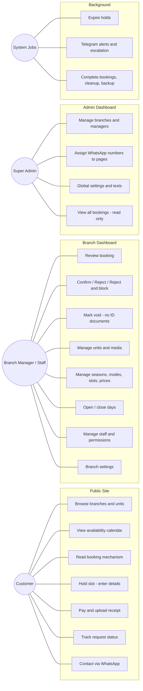

### 7.2 Class Diagram (Domain)

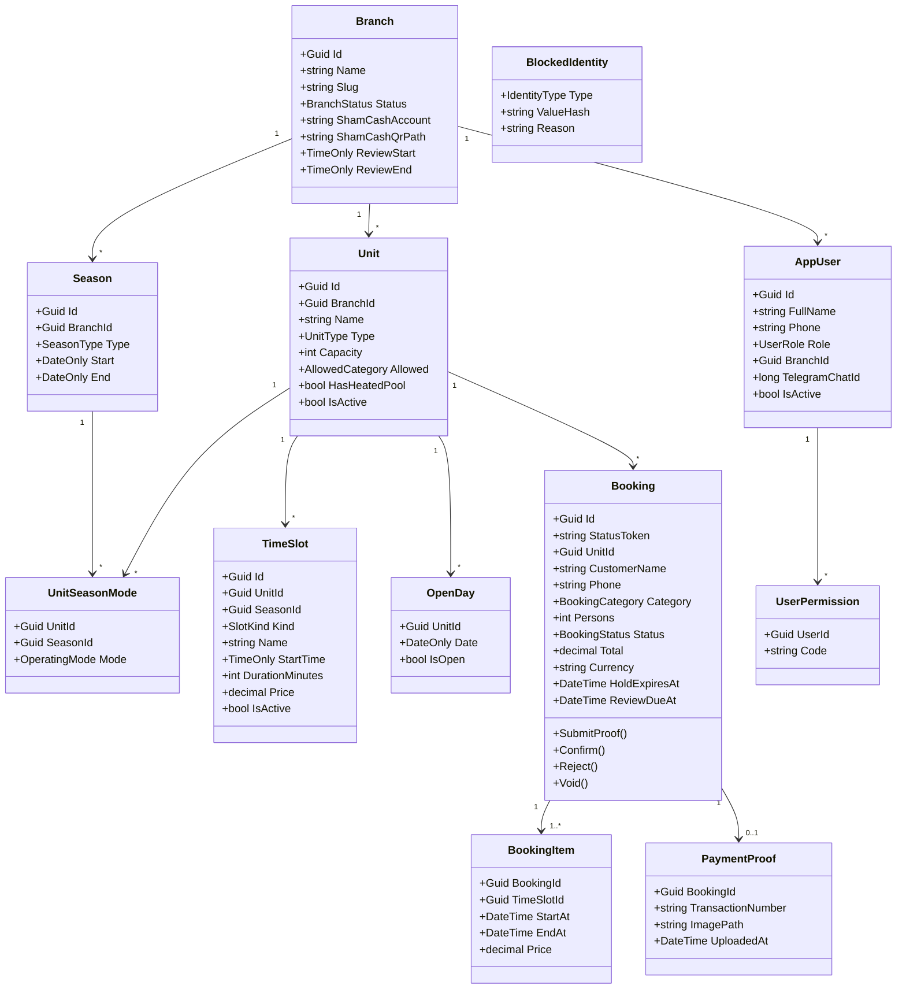

### 7.3 Sequence: الحجز والدفع

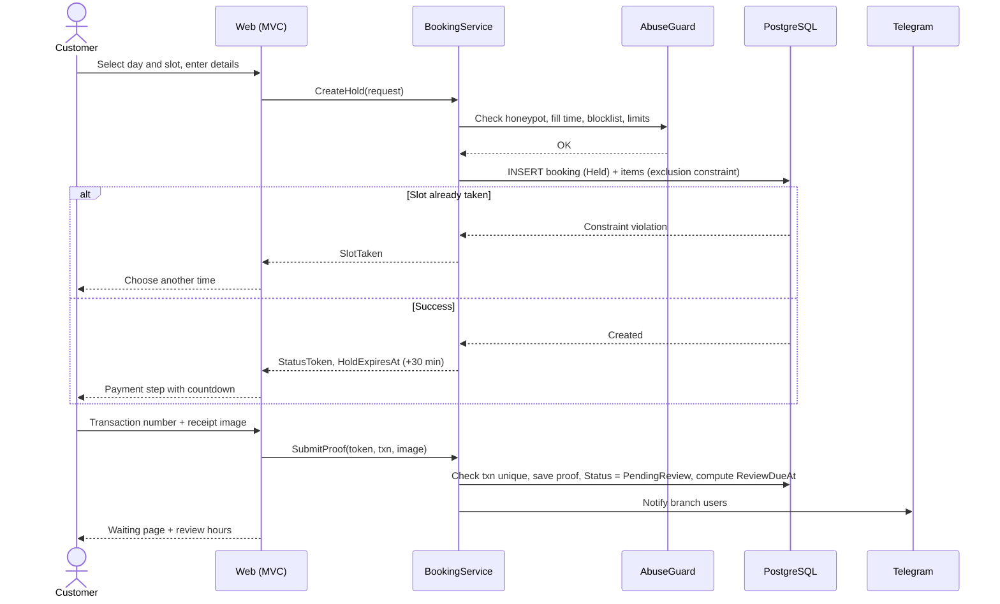

### 7.4 Sequence: المراجعة والتثبيت

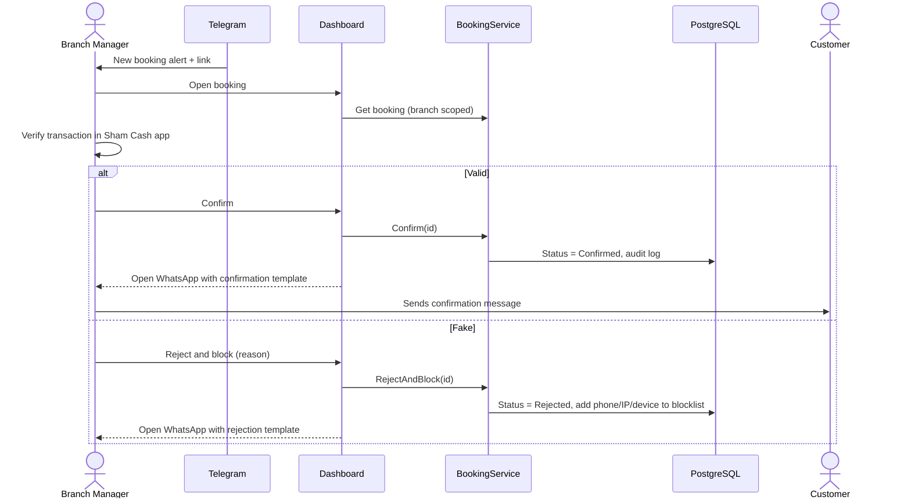

### 7.5 Activity: رحلة الحجز الكاملة

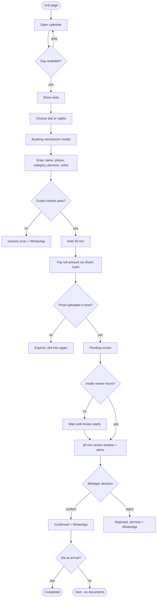

### 7.6 State: حالات الحجز

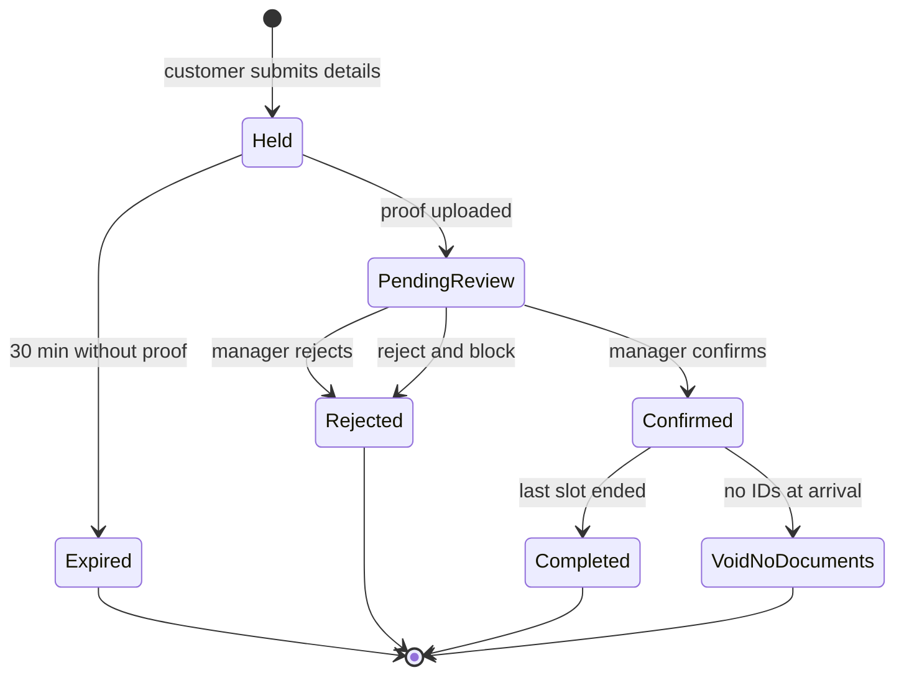

الحالات التي تشغل الوقت: Held وPendingReview وConfirmed. لا يوجد انتقال "إلغاء من الزبون".

## 8. مخطط ERD وقاموس البيانات

قاعدة البيانات PostgreSQL وفيها 20 جدولًا، والمفاتيح من نوع UUID والأوقات timestamptz بـ UTC.

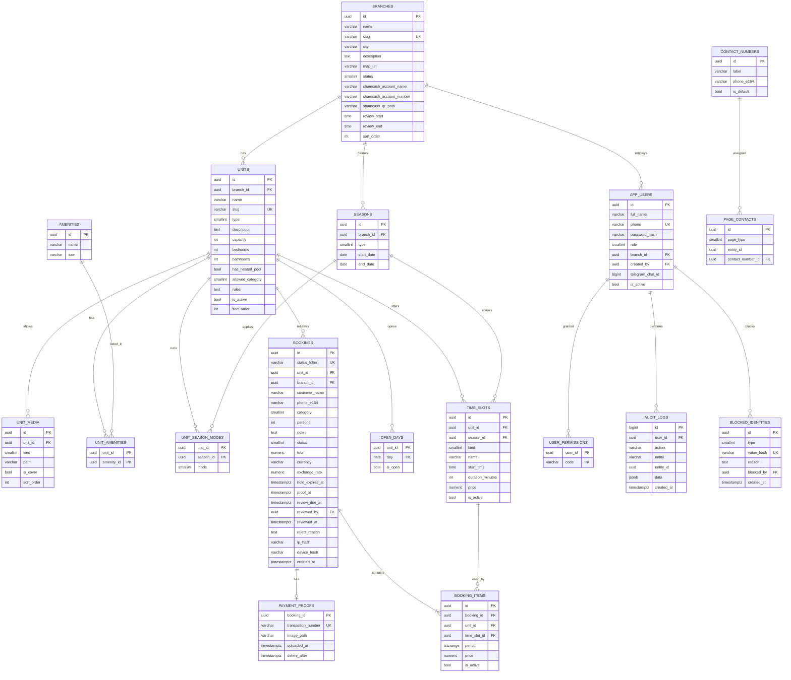

إضافة لها: جدول **SETTINGS** (key, value) للإعدادات العامة، وجدول **MESSAGE\_TEMPLATES** (key, body) لقوالب الرسائل.

### 8.1 القيم الثابتة (Enums)

| Enum | القيم |
| --- | --- |
| BranchStatus | 0 Active · 1 ComingSoon · 2 Hidden |
| UnitType | 0 Chalet · 1 Farm |
| AllowedCategory | 0 FamilyOnly · 1 FamilyAndYouth |
| SeasonType | 0 Summer · 1 Winter · 2 Spring · 3 Autumn |
| OperatingMode | 0 Pool · 1 Hotel |
| SlotKind | 0 Hours6 · 1 Hours10 · 2 FullDay · 3 HotelNight |
| BookingCategory | 0 Family · 1 Youth |
| BookingStatus | 0 Held · 1 PendingReview · 2 Confirmed · 3 Rejected · 4 Expired · 5 Completed · 6 VoidNoDocuments |
| UserRole | 0 SuperAdmin · 1 BranchManager · 2 Staff |
| IdentityType | 0 Phone · 1 Ip · 2 Device |
| PageType | 0 Home · 1 Branch · 2 Unit · 3 Terms · 4 BookingStatus |

### 8.2 القيود والفهارس الحرجة

| الجدول | القيد / الفهرس | السبب |
| --- | --- | --- |
| booking\_items | `EXCLUDE USING gist (unit_id WITH =, period WITH &&) WHERE (is_active)` | منع الحجز المزدوج نهائيًا. is\_active = false عند Expired / Rejected / VoidNoDocuments |
| seasons | `EXCLUDE USING gist (branch_id WITH =, daterange(start_date, end_date, '[]') WITH &&)` | منع تداخل المواسم |
| payment\_proofs | UNIQUE (transaction\_number) | رقم العملية لا يتكرر |
| bookings | INDEX (status, hold\_expires\_at) | مهمة إنهاء الحجوزات المؤقتة |
| bookings | INDEX (phone\_e164, status) · INDEX (ip\_hash, created\_at) | حدود الحماية |
| bookings | INDEX (branch\_id, status, review\_due\_at) | قائمة المراجعة والتصعيد |
| time\_slots | CHECK (duration\_minutes BETWEEN 60 AND 1440) · CHECK (price >= 0) | صحة البيانات |
| units | CHECK (capacity > 0) | صحة البيانات |

**حساب النطاق الزمني:** period = \[تاريخ اليوم + start\_time، بداية + duration\_minutes) بتوقيت دمشق، ويُحوّل إلى UTC. الليلة الفندقية = من وقت الدخول إلى وقت الخروج في اليوم التالي (تُخزن المدة بالدقائق). الفترة تنتمي لليوم الذي تبدأ فيه، وموسم الفترة يُحدد بيوم البداية.

## 9. المعمارية والتقنيات والاستضافة

تطبيق واحد (Modular Monolith) على ASP.NET Core 10 LTS، يولّد الصفحات من طرف السيرفر لتكون سريعة على الإنترنت الضعيف وواضحة لمحركات البحث.

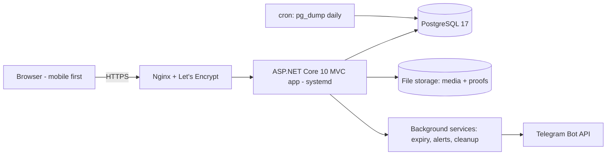

| الطبقة | الاختيار | السبب |
| --- | --- | --- |
| الإطار | ASP.NET Core 10 (LTS) MVC + Razor Views | دعم طويل (3 سنوات)، صفحات سريعة وSEO ممتاز |
| التفاعلية | Alpine.js + Fetch للتقويم والنوافذ | خفيفة جدًا بدل SPA ثقيلة |
| التنسيق | Tailwind CSS (Standalone CLI) مع متغيرات الهوية وRTL | تصميم راقٍ وملف CSS صغير، بدون Node على السيرفر |
| البيانات | EF Core 10 + Npgsql + PostgreSQL 17 | نطاقات زمنية وExclusion Constraint لمنع التداخل |
| الدخول | ASP.NET Core Identity + Cookie | جاهز وآمن |
| المهام الخلفية | BackgroundService / PeriodicTimer | بدون اعتماديات إضافية |
| الصور | SkiaSharp (ترخيص MIT) للتحويل إلى WebP وتغيير المقاس | مجاني للاستخدام التجاري |
| الحماية | Rate Limiting المدمج + AbuseGuard خاص | القسم 5.1 |
| السجلات | Serilog إلى ملفات يومية | تتبع الأخطاء |
| الاستضافة | Hostinger VPS KVM 2 — Ubuntu 24.04 + Nginx + systemd | الاستضافة المشتركة لا تدعم ASP.NET Core |

### 9.1 هيكل المشروع

```
SwissChalets.sln
  src/SwissChalets.Web          (Controllers, Views, Areas/Admin, Areas/Branch, wwwroot)
  src/SwissChalets.Application  (BookingService, AvailabilityService, AbuseGuard, PricingService)
  src/SwissChalets.Domain       (Entities, Enums, Domain rules)
  src/SwissChalets.Infrastructure (EF DbContext, Migrations, Telegram, ImageProcessor, FileStorage)
  tests/SwissChalets.Tests      (xUnit: availability, overlap, guard, status transitions)
```

### 9.2 نقاط الاتصال (Routes & API)

| الطريقة | المسار | الوظيفة |
| --- | --- | --- |
| GET | / | الرئيسية |
| GET | /b/{branchSlug} | صفحة الفرع |
| GET | /u/{unitSlug} | صفحة الوحدة |
| GET | /api/units/{id}/calendar?month=2026-12 | حالة كل يوم: full / partial / unavailable |
| GET | /api/units/{id}/slots?date=2026-12-05 | فترات اليوم مع السعر والحالة |
| POST | /api/bookings | إنشاء حجز مؤقت (Held) ← status\_token |
| POST | /api/bookings/{token}/proof | رقم العملية + الصورة (multipart) |
| GET | /booking/{token} | صفحة الدفع أو الحالة حسب حالة الحجز |
| GET | /terms | شروط الحجز |
| GET/POST | /branch/bookings, /branch/bookings/{id}/confirm · reject · block · void | مراجعة الحجوزات |
| GET/POST | /branch/units · seasons · slots · calendar · staff · blocklist · settings | إدارة الفرع |
| GET | /branch/proofs/{bookingId} | صورة الإشعار (بصلاحية فقط) |
| GET/POST | /admin/branches · users · contacts · settings · templates · bookings · audit | المدير العام |
| GET | /health | فحص الصحة |

الـ status\_token رابط سري عشوائي (32 حرفًا) يبقى في متصفح الزبون، وليس كود حجز يُطلب منه حفظه.

## 10. خريطة الموقع وتقسيم الواجهات

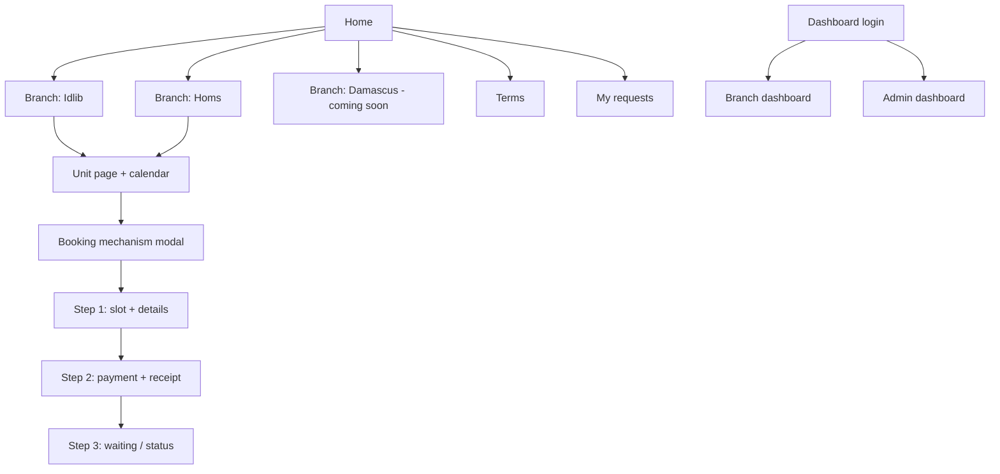

### 10.1 واجهات الموقع العام

| الواجهة | الهدف | المكونات | الحالات الخاصة |
| --- | --- | --- | --- |
| الرئيسية | انطباع فخم خلال 3 ثوانٍ ثم التوجه لفرع | شريط علوي شفاف يتحول لصلب عند التمرير، واجهة (Hero) بصورة/فيديو كامل الشاشة مع عنوان وزر "استكشف الفروع"، بطاقات الفروع الكبيرة، وحدات مميزة (شريط أفقي)، قسم "كيف تحجز" بـ 4 خطوات، قسم المواسم (صيفي / شتوي مدفأ / فندقي)، تذييل | فرع دمشق: بطاقة بشارة "قريبًا" غير قابلة للضغط |
| الفرع | اختيار الوحدة | غلاف الفرع، وصف قصير، الخريطة، أوقات المراجعة، شرائح التصفية (كوخ / مزرعة / عائلي فقط / السعة)، شبكة بطاقات الوحدات (صورة، الاسم، السعة، شارة النمط، "يبدأ من") | لا وحدات مطابقة: رسالة وزر إزالة التصفية |
| الوحدة | القناعة ثم الحجز | معرض صور (شبكة 5 صور على الحاسوب، سحب بالإصبع على الموبايل، عارض بملء الشاشة)، الاسم والفرع، شارات (السعة، الغرف، عائلي فقط، مسبح مدفأ)، المرافق بأيقونات، القواعد، لوحة الحجز (ثابتة جانبيًا على الحاسوب، شريط سفلي ثابت على الموبايل): التقويم + الفترات + زر "احجز الآن" | تحميل: هياكل (Skeleton)؛ شهر بلا أيام متاحة: "لا توجد أيام متاحة هذا الشهر" + زر الشهر التالي |
| نافذة آلية الحجز | الفهم قبل البدء | 4 خطوات بأيقونات، أوقات مراجعة الفرع، ملاحظة الثبوتيات، ملاحظة عدم الإلغاء، زر "متابعة" (النص في القسم 12.6) | تظهر على الموبايل كلوح سفلي (Bottom Sheet) |
| الخطوة 1 | تثبيت الاختيار | ملخص الفترة والسعر، الاسم، رقم الواتساب (مفتاح +963 ثابت)، عائلي / شبابي (أزرار كبيرة)، عدد الأشخاص (− / +) حتى السعة، ملاحظات، زر "احجز الوقت وانتقل للدفع" | خطأ حقل: رسالة تحت الحقل؛ الوقت حُجز للتو: رسالة + تحديث |
| الخطوة 2 | الدفع | عداد دائري 30:00، المبلغ بخط كبير، بطاقة شام كاش (الاسم، الرقم + نسخ، QR)، حقل رقم العملية، منطقة رفع الصورة مع معاينة، زر "أرسل للمراجعة" | آخر 5 دقائق: العداد بلون التحذير؛ انتهاء: شاشة "انتهت المهلة"؛ رقم عملية مكرر: رسالة خطأ |
| الخطوة 3 / الحالة | الطمأنينة | أيقونة حالة متحركة بهدوء، الحالة، ملخص الحجز، أوقات المراجعة، الثبوتيات المطلوبة، زر واتساب | مثبّت: لون النجاح + الخريطة؛ مرفوض: السبب + واتساب؛ خارج أوقات المراجعة: "ستتم المراجعة الساعة 9:00" |
| طلباتي | العودة للحالة | قائمة الطلبات المحفوظة في المتصفح | فارغة: "لا توجد طلبات على هذا الجهاز" |
| الشروط | الشفافية | نص منسق يحرره المدير العام | — |
| الزر العائم | الاستفسار | دائرة 56 px بلون واتساب #25D366 أسفل اليسار (عكس اتجاه القراءة)، تلميح "اسألنا" يظهر مرة واحدة | يرتفع فوق شريط الحجز السفلي على الموبايل |
| 404 / خطأ | الاسترجاع | رسالة لطيفة + عودة للرئيسية | — |

### 10.2 واجهات لوحة الفرع

| الواجهة | المكونات |
| --- | --- |
| تسجيل الدخول | الشعار، رقم الموبايل، كلمة المرور، تذكّرني |
| الرئيسية | بطاقات: بانتظار التأكيد (باللون الذهبي)، اليوم، الغد؛ قائمة "يحتاج مراجعتك" مرتبة حسب المهلة مع عداد لكل طلب |
| الحجوزات | تبويبات الحالات، بحث بالاسم/الرقم، تصفية بالوحدة والتاريخ، بطاقات على الموبايل وجدول على الحاسوب |
| تفاصيل الحجز | صورة الإشعار (تكبير)، رقم العملية + نسخ، المبلغ المطلوب بخط كبير، بيانات الزبون، الفترات، شريط أزرار ثابت: تثبيت (أخضر) · رفض · رفض وحظر (أحمر، مع تأكيد) · واتساب |
| التقويم التشغيلي | شبكة الوحدات × الأيام، تحديد متعدد لفتح/إغلاق الأيام، الأيام ذات الحجوزات مقفلة |
| الوحدات | قائمة + نموذج من تبويبات: البيانات · الصور (سحب وإفلات، ترتيب، غلاف) · المرافق · الفئات |
| المواسم | 4 صفوف بتواريخ، وجدول "نمط كل وحدة بكل موسم" (مسبح / فندقي) |
| الفترات والأسعار | اختيار وحدة + موسم ← قائمة فترات (الاسم، النوع، البداية، المدة، السعر)، معاينة شريط 24 ساعة تظهر التداخلات، زر "نسخ من وحدة" |
| الموظفون | قائمة، إضافة (الاسم، الرقم، كلمة مرور مؤقتة)، مربعات الصلاحيات، تعطيل |
| الحظر | قائمة المحظورين والسبب ومن حظر، رفع الحظر |
| الإعدادات | حساب شام كاش وQR، أوقات المراجعة، زر "ربط تيليغرام" (رابط t.me مع رمز ربط لكل مستخدم) |

**لوحة المدير العام:** الفروع، المستخدمون (المدراء)، أرقام التواصل وتوزيعها (جدول: الصفحة → الرقم)، الإعدادات العامة، النصوص والقوالب، كل الحجوزات (قراءة)، سجل العمليات. اللوحتان بنفس الهوية مع قائمة جانبية على الحاسوب وشريط تنقل سفلي على الموبايل.

### 10.3 Wireframes (موبايل)

```
صفحة الوحدة                         الخطوة 2 - الدفع
+---------------------------+          +---------------------------+
| [≡]   الشعار     [طلباتي] |          | ←  الدفع         (29:41) |
|---------------------------|          |---------------------------|
|                           |          |  المبلغ المطلوب           |
|   [ صورة كاملة العرض ]   |          |        $ 120              |
|        ● ○ ○ ○ ○          |          |---------------------------|
|---------------------------|          | شام كاش - فرع حمص       |
| كوخ الصنوبر · فرع حمص   |          | 0912 345 678   [نسخ]      |
| [8 أشخاص][3 غرف][مدفأ]  |          |        [ QR ]             |
|---------------------------|          |---------------------------|
| المرافق: ♨ 🏊 🔥 📶     |          | رقم العملية: [________]   |
|---------------------------|          | [ ↑ ارفع صورة الإشعار ]    |
|   ديسمبر 2026   <  >       |          |---------------------------|
| س ح ن ث ر خ ج            |          | [   أرسل للمراجعة   ]    |
| ░ ░ □ ▣ □ □ ░            |          +---------------------------+
|  □ متاح  ▣ جزئي  ░ غير متاح |
|---------------------------|
| يبدأ من $60  [احجز الآن]  (◎) <- واتساب
+---------------------------+
```

## 11. الـ Flowcharts للتدفقات الرئيسية

رحلة الحجز الكاملة موجودة في 7.5، وهنا التدفقات الداخلية التي يبنيها المبرمج.

### 11.1 فحوصات AbuseGuard عند إنشاء حجز

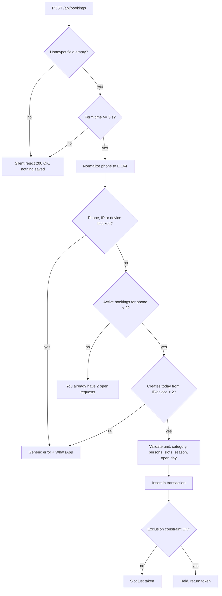

### 11.2 حساب حالة اليوم في التقويم

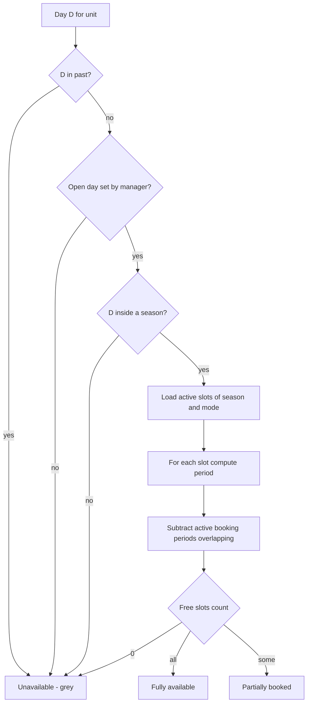

الحساب يشمل الحجوزات التي تبدأ في اليوم السابق وتمتد إلى D (مثل اليومي أو الليلة الفندقية). النتيجة تُحسب لشهر كامل باستعلام واحد، وتُخزن مؤقتًا 30 ثانية وتُمسح عند أي تغيير على حجوزات الوحدة.

### 11.3 التنبيهات والتصعيد

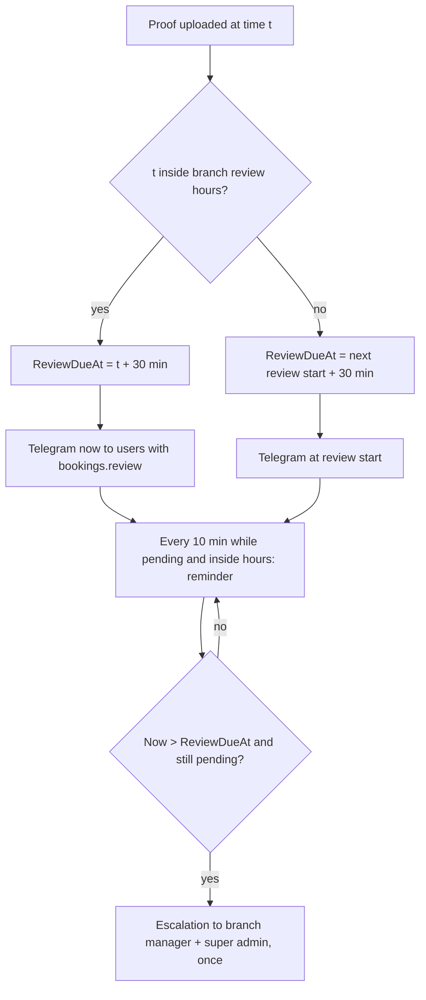

### 11.4 المهام الخلفية الدورية

| المهمة | التكرار | العمل |
| --- | --- | --- |
| HoldExpiryJob | كل دقيقة | Held + hold\_expires\_at < now ← Expired وis\_active = false |
| ReviewAlertJob | كل دقيقة | التنبيهات والتذكير والتصعيد (11.3) |
| CompletionJob | كل ساعة | Confirmed وآخر فترة انتهت ← Completed |
| ProofCleanupJob | يوميًا 03:00 | حذف صور الإشعارات الأقدم من 6 أشهر (يبقى رقم العملية) |
| Backup (cron) | يوميًا 04:00 | pg\_dump مضغوط والاحتفاظ بآخر 14 نسخة |

## 12. الهوية البصرية

الاتجاه: **فخامة جبلية عصرية (Modern Alpine Luxury)**، فيها هدوء الغابة ودفء الخشب ولمعة نحاسية ذهبية. الصور الكبيرة هي البطل، والواجهة هادئة وواسعة مثل الفنادق البوتيك.

### 12.1 الشعار

- **الرمز:** سقف كوخ مثلثي (A-frame) بخط رفيع، تحته موجة ماء منحنية واحدة ترمز للمسبح، وداخل المثلث شجرة صنوبر بمساحة سالبة.
- **النص:** "الأكواخ السويسرية" بخط Alexandria وزن 600، وتحته "SWISS CHALETS" بخط Cormorant Garamond مع تباعد أحرف 0.3em.
- **النسخ:** أخضر غابي على فاتح، كريمي على غامق، رمز فقط (أيقونة المتصفح 32 px، وأيقونة التطبيق 512 px).
- **التنفيذ:** SVG بخطوط strokes بسماكة ثابتة، مساحة أمان حول الشعار تساوي ارتفاع السقف.

### 12.2 لوحة الألوان

| الاسم (Token) | HEX | الاستخدام | التباين |
| --- | --- | --- | --- |
| Forest — primary | #1F3D2E | الأزرار الأساسية، العناوين، التذييل، اليوم المختار | 10.8:1 على Snow · الأبيض عليه 11.9:1 |
| Forest Deep | #142A1F | حالة الضغط والخلفيات الغامقة | — |
| Brass Gold — accent | #C9A45C | الخطوط الزخرفية، الأيقونات على الغامق، النجوم، الشارات | 5.1:1 على Forest · **لا يُستخدم كنص على الأبيض** (2.3:1) |
| Gold Deep | #8F6B2A | نص ذهبي على خلفية فاتحة | 4.9:1 على الأبيض |
| Walnut — secondary | #8A5A3B | العناوين الفرعية والروابط الثانوية | 5.3:1 على Snow |
| Pool Teal | #2E6F73 | كل ما يخص نمط المسبح والمسبح المدفأ | 5.8:1 على الأبيض |
| Snow — background | #F7F3EC | خلفية الصفحات | — |
| Surface | #FFFFFF | البطاقات والنوافذ | — |
| Ink — text | #2B2A26 | النص الأساسي | 13:1 على Snow |
| Stone — muted | #6B665D | النص الثانوي | 5.2:1 على Snow |
| Line | #E4DDD1 | الحدود والفواصل | — |
| Success | #2E7D4F | مثبّت، زر التثبيت | الأبيض عليه 5:1 |
| Warning | #B7791F | بانتظار التأكيد، آخر 5 دقائق بالعداد | مع نص Ink |
| Error | #B3261E | الرفض، الحظر، الأخطاء | الأبيض عليه 6.5:1 |
| WhatsApp | #25D366 | الزر العائم فقط (لون العلامة الرسمي) | أيقونة بيضاء |

**ألوان التقويم:**

| الحالة | الخلفية | النص / الإطار |
| --- | --- | --- |
| متاح بالكامل | #FFFFFF | نص Forest، إطار Forest بسماكة 1px |
| محجوز جزئيًا | #F3E7CC | نص Forest (9.7:1) + نقطة ذهبية تحت الرقم |
| غير متاح | #ECE9E3 | نص #9A968E مع خط مائل رفيع، غير قابل للضغط (العناصر المعطلة مستثناة من شرط التباين) |
| مختار | #1F3D2E | نص أبيض |
| اليوم | — | حلقة Brass Gold |

مفتاح الألوان يظهر دائمًا تحت التقويم، لأن اللون وحده لا يكفي.

### 12.3 الخطوط

| الدور | الخط | الحجم (موبايل / حاسوب) | الوزن |
| --- | --- | --- | --- |
| Display (عنوان الواجهة) | Alexandria | 36 / 64 px، ارتفاع سطر 1.2 | 600 |
| H1 | Alexandria | 28 / 40 | 600 |
| H2 | Alexandria | 22 / 30 | 500 |
| H3 | Alexandria | 18 / 22 | 500 |
| النص | IBM Plex Sans Arabic | 16 / 17، ارتفاع سطر 1.8 | 400 |
| صغير / تسميات | IBM Plex Sans Arabic | 13 / 14 | 500 |
| لمسة لاتينية فاخرة | Cormorant Garamond | للعبارات القصيرة فقط | 500 italic |

الخطوط تُستضاف محليًا بصيغة WOFF2 مع font-display: swap وتحميل مسبق للوزنين الأساسيين فقط. الأرقام غربية (0–9) لوضوح الأسعار والأوقات، مع tabular-nums في العداد والأسعار.

### 12.4 المسافات والأشكال والحركة

- **المسافات:** مقياس 8 px (4، 8، 16، 24، 32، 48، 64، 96)، والأقسام تفصل بينها 96 px على الحاسوب و64 على الموبايل. أقصى عرض للمحتوى 1200 px.
- **الزوايا:** الأزرار والحقول 12 px، البطاقات 20 px، الصور الكبيرة 28 px، الشارات بشكل كبسولة.
- **الظلال:** ظل واحد ناعم للبطاقات `0 10px 30px rgba(31,61,46,.08)`، وللنوافذ `0 24px 60px rgba(20,42,31,.18)`.
- **الحركة:** 200–320ms بمنحنى cubic-bezier(.2,.8,.2,1). الصور تظهر تدريجيًا مع تكبير بسيط (scale 1.02 ← 1)، وبطاقات الوحدات ترتفع 4px عند التمرير. نحترم prefers-reduced-motion.
- **الزجاج (Glass):** الشريط العلوي فوق الواجهة شفاف مع backdrop-blur(12px)، ويصبح Snow بعد 80 px من التمرير.
- **الأيقونات:** Lucide بسماكة خط 1.5، ومقاس 20 / 24 px.
- **الصور:** دافئة بضوء طبيعي (الساعة الذهبية أو إضاءة المسبح ليلًا)، بنسبة 4:3 للبطاقات و16:9 للواجهة، مع طبقة تدرج Forest بشفافية 55% خلف النص.

### 12.5 المكونات

| المكون | المواصفات | الحالات |
| --- | --- | --- |
| زر أساسي | Forest، نص أبيض 600، ارتفاع 52 px، زوايا 12 | hover: Forest Deep · focus: حلقة ذهبية 2px · تحميل: مؤشر دوار · معطل: شفافية 40% |
| زر ثانوي | إطار Forest، خلفية شفافة | hover: خلفية Forest 6% |
| بطاقة الوحدة | صورة 4:3، شارة النمط على الصورة (مسبح Teal / فندقي Walnut)، الاسم H3، السعة، "يبدأ من $X" | hover: ارتفاع + تكبير الصورة |
| بطاقة الفرع | صورة طولية 3:4 بملء البطاقة، الاسم بـ Display أبيض، عدد الوحدات | قريبًا: تدرج رمادي + شارة ذهبية |
| التقويم | خلايا 44×44 px، أيام الأسبوع تبدأ بالسبت، سهما الشهر | الحالات في 12.2 |
| رقائق الفترات | بطاقة أفقية: الاسم، الوقت (10:00 – 16:00)، النوع، السعر | متاح / مختار (إطار Forest 2px + علامة ✓) / محجوز (رمادي + "محجوزة") |
| حقل إدخال | ارتفاع 52 px، تسمية فوق الحقل، إطار Line | focus: إطار Forest · خطأ: إطار Error + رسالة |
| العداد التنازلي | حلقة تقدم دائرية بلون Forest | آخر 5 دقائق: Warning |
| شارة الحالة | كبسولة بنص 13px | مؤقت (Stone) · بانتظار (Warning) · مثبّت (Success) · مرفوض (Error) · منتهي / مكتمل (Stone) |
| النافذة | مركزية بعرض 560 على الحاسوب، لوح سفلي على الموبايل، سحب للأسفل للإغلاق | خلفية معتمة 60% |

### 12.6 نبرة الكتابة والنصوص الجاهزة

النبرة فصحى مُبسّطة، دافئة ومختصرة. نكتب "احجز" بدل "قم بالحجز"، ولا نستخدم علامات تعجب متكررة.

- **عنوان الواجهة:** "هدوء الجبال، بلمسة سويسرية"
- **العنوان الفرعي:** "أكواخ ومزارع بمسابح خاصة، صيفًا وشتاءً، في إدلب وحمص"

**نص نافذة آلية الحجز** (قابل للتعديل من المدير العام):

```
كيف يتم الحجز؟

1. اختر الوقت وأدخل بياناتك
   سنحجز الوقت باسمك لمدة 30 دقيقة.

2. ادفع المبلغ كاملًا عبر شام كاش
   إلى حساب الفرع الظاهر في صفحة الدفع.

3. أدخل رقم العملية وارفع صورة الإشعار
   قبل انتهاء الـ 30 دقيقة.

4. نراجع الدفع ونؤكد حجزك عبر واتساب
   أوقات المراجعة في فرع {الفرع}: من {البداية} إلى {النهاية}.
   الطلبات خارج هذه الأوقات تبقى محجوزة باسمك
   وتُراجَع أول المراجعة.

ملاحظات مهمة:
• الحجز غير قابل للإلغاء أو الاسترداد بعد تثبيته.
• عند الوصول يجب إحضار الثبوتيات:
  الحجز العائلي: الهوية + دفتر العائلة
  الحجز الشبابي: هوية واحدة
• في حال عدم إحضار الثبوتيات عند الاستلام يُعتبر الحجز لاغيًا.

[ متابعة ]
```

**قالب رسالة التثبيت (واتساب):**

```
مرحبًا {الاسم} 🌲
تم تثبيت حجزك في {الوحدة} - فرع {الفرع}.
الموعد: {التاريخ} من {البداية} إلى {النهاية}
الموقع: {رابط الخريطة}
يرجى إحضار: {الثبوتيات}
ننتظركم - الأكواخ السويسرية
```

**قالب رسالة الرفض:**

```
مرحبًا {الاسم}،
نعتذر، لم نتمكن من تثبيت طلبك في {الوحدة} بتاريخ {التاريخ}.
السبب: {السبب}
للاستفسار يسعدنا تواصلك على هذا الرقم.
```

## 13. الاختبارات وخطة الإطلاق والمخاطر

### 13.1 سيناريوهات الاختبار الإلزامية قبل الإطلاق

| # | السيناريو | النتيجة المتوقعة |
| --- | --- | --- |
| T-01 | زبونان يحجزان نفس الفترة بنفس اللحظة | واحد ينجح، والثاني يصله "حُجز للتو" |
| T-02 | حجز 6 ساعات صباحية ثم محاولة حجز اليومي | اليومي رمادي، واليوم "محجوز جزئيًا" |
| T-03 | حجز يومي يبدأ 12:00 وينتهي 12:00 اليوم التالي | فترات صباح اليوم التالي المتداخلة مقفلة |
| T-04 | لا يُرفع إشعار خلال 30 دقيقة | Expired، والفترة تعود متاحة خلال دقيقة |
| T-05 | إشعار الساعة 1:00 ليلًا (المراجعة تبدأ 9:00) | يبقى محجوزًا، تنبيه 9:00، تصعيد 9:30 إذا لم يُراجَع |
| T-06 | رقم عملية مستخدم سابقًا | رفض مع رسالة واضحة |
| T-07 | الرقم نفسه يفتح طلبًا ثالثًا ولديه طلبان معلقان | مرفوض |
| T-08 | الرقم نفسه بصيغتين (09… و +9639…) | يُعامل كرقم واحد |
| T-09 | "رفض وحظر" ثم محاولة حجز من نفس الجهاز برقم آخر | مرفوض |
| T-10 | المدير يغلق يومًا فيه حجز مثبّت | ممنوع مع عرض الحجز |
| T-11 | موسم متداخل مع موسم آخر | مرفوض |
| T-12 | وحدة عائلية فقط | خيار "شبابي" مخفي ومرفوض من السيرفر |
| T-13 | موظف فرع حمص يفتح رابط حجز في فرع إدلب | 404 |
| T-14 | موظف بدون bookings.review يحاول التثبيت | 403 |
| T-15 | الصفحة الرئيسية على Slow 3G في Chrome DevTools | تظهر خلال 2.5 ثانية |
| T-16 | Lighthouse موبايل | Performance ≥ 85، Accessibility ≥ 95 |

اختبارات xUnit تغطي: حساب النطاقات والتداخل (ومنها عبور منتصف الليل)، حالة اليوم، AbuseGuard، انتقالات الحالة، وحساب ReviewDueAt.

### 13.2 خطة الإطلاق خلال يومين

| الوقت | العمل | المسؤول |
| --- | --- | --- |
| اليوم 1 — صباحًا | شراء VPS KVM 2 والدومين، إعداد السيرفر، هيكل المشروع، قاعدة البيانات والـ Migrations | الفريق + Claude |
| اليوم 1 — مساءً | الموقع العام والهوية، التقويم، مسار الحجز والدفع، AbuseGuard | Claude |
| اليوم 2 — صباحًا | لوحة الفرع كاملة، لوحة المدير العام المبسطة، تيليغرام، المهام الخلفية | Claude |
| اليوم 2 — ظهرًا | رفع الموقع، SSL، النسخ الاحتياطي، إدخال المحتوى (الوحدات، الصور، المواسم، الفترات، الأسعار، حسابات شام كاش) | الفريق + مدراء الفروع |
| اليوم 2 — مساءً | الاختبارات T-01 → T-16، حجز تجريبي حقيقي، ثم الإطلاق | الفريق |

### 13.3 المخاطر والتخفيف

| الخطر | الأثر | التخفيف |
| --- | --- | --- |
| المحتوى (صور وأسعار) غير جاهز | تأخير الإطلاق | تجهيزه من الآن، ومهلة نهائية ظهر اليوم 2 |
| صور ضعيفة الجودة | تضعف الفخامة المطلوبة | تصوير أفقي بضوء النهار والغروب، لا تقل عن 1600 px |
| تأخر المراجعة | زبائن قلقون | تيليغرام + تذكير + تصعيد + موظف مساعد |
| مهاجم بأرقام وأجهزة كثيرة | تعطيل أوقات | الحدود مع الحظر الفوري. المدير العام يستطيع تشديد الحدود من الإعدادات |
| تعطل السيرفر | توقف الحجز | systemd مع نسخ يومي وأسبوعي، ومراقبة /health |
| تغير آلية شام كاش أو العملة | أسعار غير دقيقة | العملة وسعر الصرف إعدادات قابلة للتغيير |

### 13.4 الافتراضات

- مدير النظام هو نفسه المدير العام، ولا يثبّت الحجوزات.
- الاسم اللاتيني للموقع "Swiss Chalets"، والدومين يُحدد عند الشراء.
- مهلة الـ 30 دقيقة بعد بدء أوقات المراجعة (BR-23) هي مهلة المدير لمراجعة الطلبات الليلية، وليست مهلة تُلغي الحجز.
- المرافق قائمة قابلة للتوسعة تبدأ بـ: مسبح، مسبح مدفأ، شواء، تدفئة، تكييف، واي فاي، مطبخ، موقف سيارات، ألعاب أطفال، جلسة خارجية.
